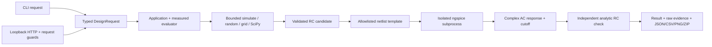

# Implemented architecture and interface contracts

Implementation update (2026-11-19): domain, synthesis, simulation, CLI, bisection, classical baselines and tolerance experiments are implemented and tested. Phase 5 adds shared typed application contracts, JSON/CSV/PNG/ZIP export and a bounded local FastAPI service. optimization/base.py owns constraint/measurement/reference/target evaluation and budgets; optimization/baselines.py owns seeded random/grid/SciPy. evaluation/records.py exports genuine responses and environment fingerprints. See docs/PHASE2.md through docs/PHASE5.md. The optional frontend remains deferred.

## Implemented flow



The optional local proposal experiment has a separate explicit resource policy;
it can propose only typed candidates and cannot supply netlists or shell tools.
Development Freebuff review is a different advisory workflow, outside the
electrical execution path. The read-only research exporter consumes existing
evidence without invoking either model or simulator.

## Source layout

```text
src/circuforge/
  contracts.py           # bounded shared CLI/API request/result/waveform schemas
  proposals.py           # isolated offline provider contract, validation and quota ledger
  local_provider.py      # optional pinned loopback Ollama client, durable global limits
  application.py         # measured design and traceable export use case
  api.py                 # loopback-only FastAPI, bounded requests/work and temp cleanup
  domain/specs.py         # Pydantic specs, units, validity
  domain/tolerance.py     # typed independent multiplicative errors and RNG streams
  synthesis/rc.py        # trusted topology templates -> netlist
  simulation/ngspice.py  # executable preflight, bounded subprocess, parser
  simulation/metrics.py  # complex transfer function, cutoff, errors
  optimization/base.py   # candidate/objective/fitness and budget
  optimization/baselines.py # seeded random/grid/SciPy differential evolution
  optimization/robustness.py # matched-call nominal/robust study with untouched holdout
  evaluation/records.py  # raw response CSV and environment/source fingerprints
  evaluation/acceptance.py # shared raw physics/evidence audits
  evaluation/benchmark.py # typed feasible/infeasible fixtures, multi-seed runs, exact replay
  evaluation/statistics.py # empirical quantiles/pass rates; failures block statistics
  evaluation/robust_acceptance.py # sampling, raw-physics, objective, holdout and replay audit
  evaluation/robust_plot.py # optional Matplotlib scientific artifact
  evaluation/design_acceptance.py # raw exports, ZIP integrity, interface/install audit
  evaluation/local_trial.py # scoped local-only proposal experiment and closed-allowance guard
  cli.py                 # command-line demo
 tests/{unit,integration}/
 examples/
 docs/
```

Runtime core dependencies are NumPy, SciPy and Pydantic on Python 3.11+. Matplotlib,
FastAPI/HTTPX/Uvicorn and pytest are declared through report/API/test extras;
the optional local-model extra provides HTTPX. `ngspice` is a separate external
executable, detected through PATH or a trusted operator override. See
[OPERATIONS.md](OPERATIONS.md) for setup and failure diagnosis.

## Contracts

`DesignInputs` validates the filter kind, positive target, SI R/C bounds, ideal
source/load, continuous-value policy and sweep/evaluation/resource settings.
`DesignSpec` additionally checks target feasibility within the declared tolerance.
Intentionally infeasible benchmark inputs never bypass candidate validation.

`CircuitCandidate` contains only topology, resistance and capacitance. Netlist
text is generated separately by the trusted template; it is not a candidate field.

`SimulationResult` retains the parsed `Response`, trusted netlist, executable,
version, argument tuple, sanitized stdout/stderr, return code, elapsed time and
success status. `SimulationError` carries subprocess/parser failure details.

`Evaluation` records candidate, status, objective, constraints, simulator exit,
independent verification, target success, measured/analytic errors, charged call,
latency, artifact and failure reason. These flags are separate: simulator success
does not imply numerical verification or target success.

`DesignRequest`/`DesignResult`/`Waveform` are the shared bounded CLI/API schemas.
Benchmark and tolerance summaries preserve task/seed/method/call partitions and
source fingerprints. Proposal usage and provider errors have a separate ledger;
there is no generic `ExperimentRecord` class claiming to cover every experiment.

## Test pyramid

1. Analytic RC formula and validation unit tests without simulator.
2. Trusted netlist generation golden tests and input-injection rejection.
3. ngspice real executable integration test (must visibly skip/fail if binary absent).
4. Equal-budget optimizer tests and replay.
5. Robustness sampling tests, benchmark regression and optional API/UI integration.

Record exact simulator commands, package/environment versions and reproducible fixtures. No numeric assertions based on LLM text.

Phase 3 adds a versioned bounded manifest and experiment/replay harness; see docs/PHASE3.md. DesignInputs validates supported, well-formed electrical requests before DesignSpec checks achievable target feasibility. This allows intentionally infeasible benchmark constraints without bypassing safety validation. All simulated candidates still require DesignSpec and the existing trusted adapter. The shared audit_run checker verifies every method's raw data, independently of benchmark summary generation. scripts/accept_phase3.py combines full tests, two fresh runs and exact numerical replay; target misses and expected pre-simulation rejections remain separate outcomes.

Phase 4 reuses Evaluator for every nominal and perturbed measurement. Original nominal bounds remain the optimizer contract; a typed expanded simulation spec represents permitted tolerance realizations and preserves topology, target/error policy, source/load and simulator guardrails. Independent RNG streams separate proposals, shared training factors and fresh holdout factors. The measured nominal objective and tolerance penalty use actual SPICE cutoff errors. Raw audit_evaluation is shared by the historical baseline and new tolerance checkers; Phase 4 additionally reconstructs all perturbations, call partitions, selection and holdout statistics. Full tests and source fingerprints tie acceptance to the executed code. See docs/PHASE4.md.

Phase 5 keeps CLI and HTTP as adapters around application.run_design. Requests cannot supply netlists, executable names or artifact paths; the CLI's output path and API's trusted startup settings are separate from the electrical request. The service validates before simulator construction, rejects overlapping heavy jobs with a process-local semaphore, and materializes JSON/ZIP inside a private TemporaryDirectory before cleanup. ASGI guards cap body bytes/deadline and restrict local callers/hosts/origins. Numerical states distinguish pass, target miss and simulation failure. The acceptance command builds a wheel, installs it in a fresh environment and exercises isolated CLI plus real loopback HTTP, preserving raw data and package provenance. See docs/PHASE5.md.

The later local-only proposal experiment is an explicit opt-in script, not a
design CLI/API option. It uses the existing ProposalSession and Evaluator with
separate global model-token/time and SPICE counters. The adapter fixes loopback,
model digest, no proxy/redirect, bounded JSON and client deadlines; per-request
CPU settings and keep-alive zero are recorded. Optional HTTPX is declared by
the local-model extra. Basic design has no dependency on model access.
The read-only audit replays saved candidate/usage validation and independently
checks every physical trace, selection and actual method count. The first local
trial retained integrity but failed comparison completion at the original
deadline; its source epochs and one non-resetting continuation are explicit.
The source policy is closed to prevent accidental fresh execution. See
docs/PHASE6_LOCAL_RESULTS.md; no model efficacy or full Phase 6 pass is inferred.
