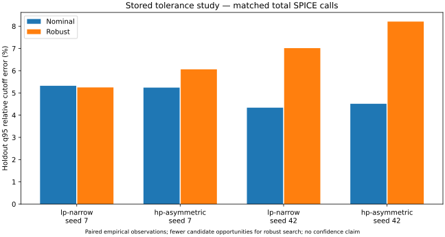

# CircuForge research report

This report reconciles stored experiments; it runs no new model or simulator.
Historical Phase 3/4 acceptance and numerical summaries are checked against their
manifests and test reports. Their raw physics audits remain historical; they are
not repeated by this exporter. Local-trial raw traces and saved model replies are
independently re-audited read-only. Input paths and SHA-256 hashes are in summary.json.

## Methods and assumptions

Ideal unloaded first-order RC low/high-pass filters use fc=1/(2*pi*R*C).
Source impedance is zero; R/C are ideal continuous values. All studies retain
their prespecified target tolerance; misses remain design failures even when engineering checks pass.
Random/grid/SciPy use matched actual simulator calls within each comparison.
These datasets have different domains/budgets and are not pooled or ranked across studies.

## Nominal benchmark

20 curated cases, 3 seeds, 180 method trials per run.
Per run: 18 design passes, 126 misses and 36 infeasible rejections; 1530 simulator calls.
The recorded exact replay accounts for 3060 audited calls in total.
Of the design passes, 18 came from fixed-component controls.
An infeasible rejection is validation, not a synthesized design. Fixed controls
and deterministic grid repetitions must not be treated as independent optimization wins.

| Method | Feasible trials | Passes | Misses | Rejections | Calls/run |
|---|---:|---:|---:|---:|---:|
| random | 48 | 6 | 42 | 12 | 510 |
| grid | 48 | 6 | 42 | 12 | 510 |
| scipy | 48 | 6 | 42 | 12 | 510 |

## Component tolerances

Independent uniform perturbations: R +/-1%, C +/-5%. These illustrative distributions are not calibrated to hardware.
Nominal search spends training calls on candidates; robust search spends part of
the same budget on perturbations, reducing candidate opportunities. Fresh paired
holdout factors never select the design. Empirical quantiles are descriptive.

| Case | Seed | Method | Nominal error % | Holdout q95 error % | Holdout passes | Calls |
|---|---:|---|---:|---:|---:|---:|
| lp-narrow | 7 | nominal | 0.208861 | 5.321266 | 0/32 | 96 |
| lp-narrow | 7 | robust | 0.678508 | 5.247147 | 1/32 | 96 |
| hp-asymmetric | 7 | nominal | 0.442508 | 5.238178 | 1/32 | 96 |
| hp-asymmetric | 7 | robust | 0.910681 | 6.060503 | 1/32 | 96 |
| lp-narrow | 42 | nominal | 0.144311 | 4.337610 | 1/32 | 96 |
| lp-narrow | 42 | robust | 3.008716 | 7.013800 | 0/32 | 96 |
| hp-asymmetric | 42 | nominal | 0.156766 | 4.511287 | 0/32 | 96 |
| hp-asymmetric | 42 | robust | 4.255853 | 8.210504 | 1/32 | 96 |

Robust holdout q95 was lower in 1 of 4 paired comparisons. This is descriptive, not a general superiority claim.

## Local-model comparison

4 matched-call comparisons; 25 model attempts; 65 actual raw-audited SPICE attempts including pilots.
Reserved tokens: 57600; known reported tokens: 3079; unknown-usage requests: 1. Known tokens exclude unknown usage.
Completed replay checks: 0; overall gate: `blocked_incomplete`.
Equal SPICE calls exclude additional inference time. This small two-topology study
does not establish general LLM superiority or topology synthesis. The earlier
partial trial is excluded. No expired allowance is reopened by reporting.

| Case | Seed | Method | Best error % | Target passed | Calls |
|---|---:|---|---:|---|---:|
| local-lowpass | 7 | random | 31.086213 | false | 4 |
| local-lowpass | 7 | grid | 30.804881 | false | 4 |
| local-lowpass | 7 | scipy | 33.170537 | false | 4 |
| local-lowpass | 7 | local_ollama | 56.184318 | false | 4 |
| local-lowpass | 42 | random | 49.826660 | false | 4 |
| local-lowpass | 42 | grid | 30.804881 | false | 4 |
| local-lowpass | 42 | scipy | 13.943464 | false | 4 |
| local-lowpass | 42 | local_ollama | 38.655136 | false | 4 |
| local-highpass | 7 | random | 31.086088 | false | 4 |
| local-highpass | 7 | grid | 30.799452 | false | 4 |
| local-highpass | 7 | scipy | 33.162748 | false | 4 |
| local-highpass | 7 | local_ollama | 81.721768 | false | 4 |
| local-highpass | 42 | random | 49.822036 | false | 4 |
| local-highpass | 42 | grid | 30.799452 | false | 4 |
| local-highpass | 42 | scipy | 13.951399 | false | 4 |
| local-highpass | 42 | local_ollama | 35.925703 | false | 4 |

## Limits and next steps

The plots show observations, not confidence intervals or population estimates.
Shared random factors, curated tasks, small training/holdout sets and ideal RC
physics limit generalization. Source/load nonidealities, discrete components,
active circuits and physical boards remain unverified. Numerical same-environment
replay is not a cross-platform promise. Engineering acceptance does not erase
target failures or grant deployment, remote push or a new provider allowance.
The scientific Phase 6 replay gap and final Phase 7 release remain open.
